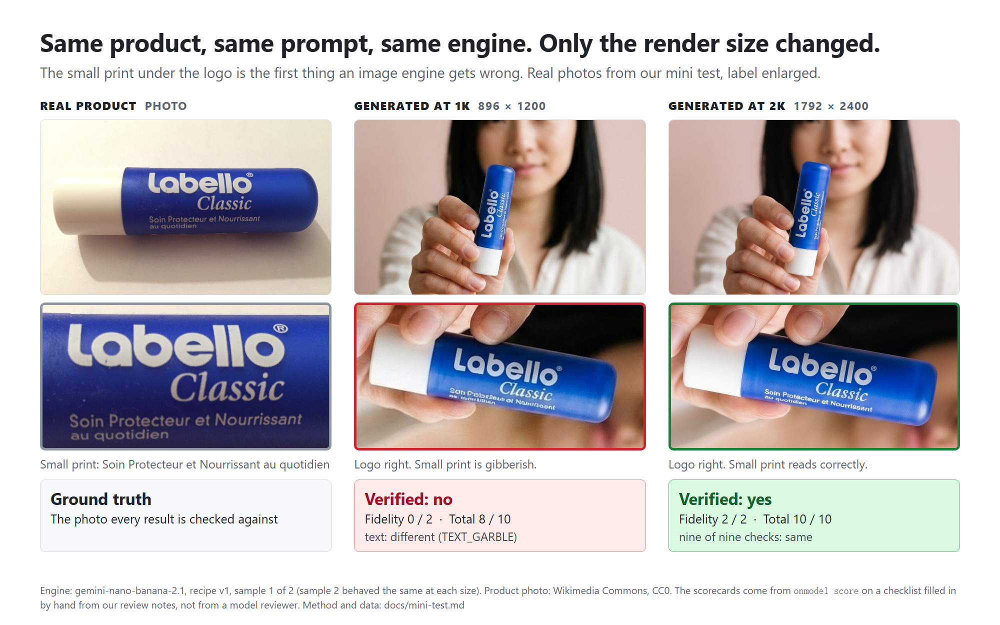
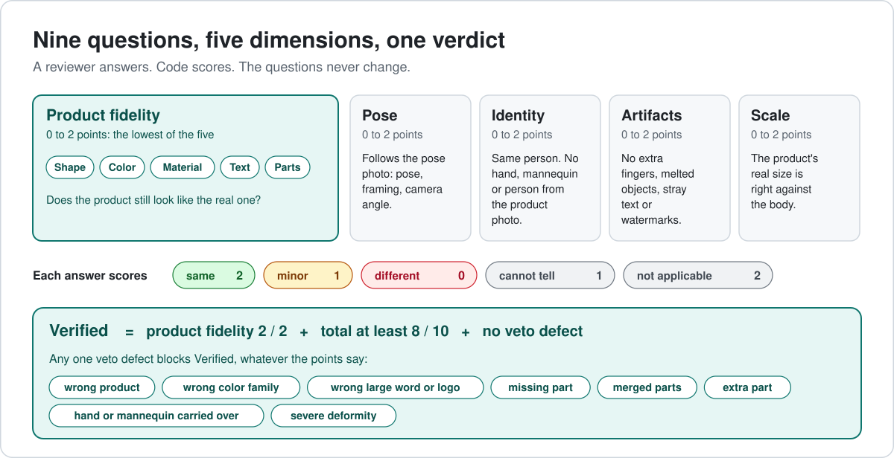
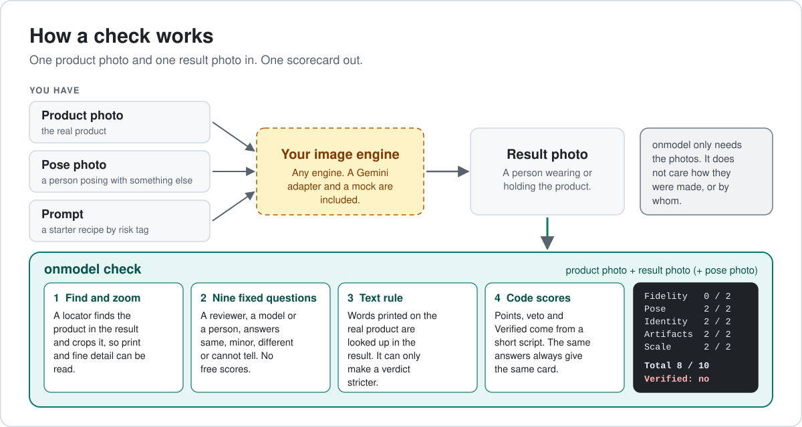
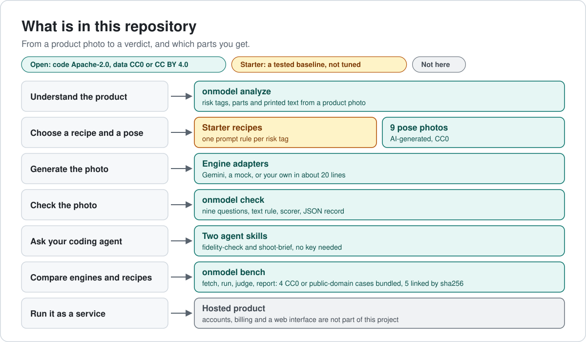

# onmodel

**Does your AI model photo still look like your product?**
Check an AI-generated on-model product photo against the real product: shape, color, material, printed text, parts and scale. One command, or one skill for your coding agent.

[](LICENSE)
[](https://github.com/molly554/onmodel/actions/workflows/ci.yml)
[中文](README.zh-CN.md)



## Try it

**As a skill.** It uses your own agent's eyes and a short script. No key; the script needs only Python 3.

```bash
git clone https://github.com/molly554/onmodel
mkdir -p ~/.claude/skills && cp -r onmodel/skills/fidelity-check ~/.claude/skills/
```

Written for Claude Code. Other agents that read `SKILL.md` folders can use the same folder; we have not tried them. A second skill, `shoot-brief`, turns a product photo into a prompt and a list of risks before you generate.

**As a command line.** Bring your own Gemini key. Reviewing a photo sends the images to Google.

```bash
pip install git+https://github.com/molly554/onmodel
export GEMINI_API_KEY=your-key
onmodel check product.jpg result.jpg --verb holding --tags text,hand
```

The exit code is 0 when the photo is Verified, 1 when it is not and 2 on an error, so it also works as a gate in a script. `onmodel score`, `onmodel recipe` and `onmodel bench smoke` need no key and no network.

## Use it

Ask your agent in your own words:

```
Does this AI photo still look like my product? [product.jpg] [result.jpg]
Check these 12 product photos before I publish them.
The label text looks off in this one. What should I change?
```

You get a scorecard. This one is the real output of `onmodel score skills/fidelity-check/references/checklist-example.json`:

```
 Fidelity   0 / 2 text: small print under the logo is gibberish
 Pose       2 / 2
 Identity   2 / 2
 Artifacts  2 / 2
 Scale      2 / 2
 ----------------------------------------------------------------
 Total 8 / 10   Veto: none   Verified: no (product fidelity is 0 / 2 (text))
 Fix: Render at 2K or higher and keep the label facing the camera.
```

It is a first screen, not a certificate. It flags what looks wrong, says "cannot tell" when it cannot read something, and suggests a fix.

## What it checks



A reviewer, a model or a person, answers nine fixed questions. A short script computes points, vetoes and the verdict, so the same answers always give the same card. A free text rule compares the words printed on the real product with what survives in the result. See the [rubric](spec/rubric.md), [what Verified means](spec/verified.md) and the [failure codes](spec/failure-taxonomy.md).

## What we found (preliminary)


From our own mini test: 52 photos of 9 products, two photos per cell, one image engine, labels made by us with AI assistance. These are directions, not pass rates. The model reviewers in that test used an earlier prompt with free 0 to 2 scores. The checklist protocol in `onmodel check` was designed in response and has not been calibrated against human labels yet. Method, data and caveats: [docs/mini-test.md](docs/mini-test.md).

## How it works



## Run the benchmark on your own engine

```bash
git clone https://github.com/molly554/onmodel && cd onmodel && pip install -e ".[dev]"
onmodel bench smoke                                                # the whole pipeline, offline, no key
onmodel bench fetch                                                # the 5 linked photos, checked against their sha256
onmodel bench run --engine gemini-nano-banana-2.1 --res 2k         # a dry run: the plan and the estimated cost
onmodel bench run --engine gemini-nano-banana-2.1 --res 2k --out my-run --yes
onmodel bench judge --run my-run
onmodel bench report --run my-run
```

Keys are read from the environment and never printed or written. A run stops at `--budget` and can be resumed. Plug in another engine in about twenty lines: [docs/bring-your-engine.md](docs/bring-your-engine.md).

## What is in the repository



| Part | License |
|---|---|
| Code, spec, starter recipes, skills | Apache-2.0 |
| Figures and annotations | CC BY 4.0 |
| 4 bundled product photos, 9 pose photos, the generated photos of the mini test | CC0 or public domain |
| 5 linked product photos (CC BY-SA) | not copied: `onmodel bench fetch` downloads them and checks the sha256 |

Every image is listed with its author, license and origin in [bench/ASSETS.json](bench/ASSETS.json) and [ATTRIBUTION.md](ATTRIBUTION.md). A script checks the list on every push.

## Limits

- This test is run by a vendor of image products. Everything needed to rerun it is here.
- One image engine (Gemini), two photos per cell, one task (swap the product).
- Labels are ours, made with AI assistance, not an independent human panel. The reviewers in the mini test were Gemini models too.
- The text rule was measured with Windows OCR, on the same photos its threshold was picked from. The OCR that ships is Tesseract, which we have not measured.
- The golden set is small: 9 cases.
- The skills are tested as scripts and as a format. We have not measured how reliably an agent follows them.
- A Verified photo has passed a screening. Look at it yourself before you publish it.

## Roadmap

Planned, with no dates: a golden set shot by us (12 products), 150 or more photos labelled by two people, a calibration card for each reviewer, more engines. No leaderboard until the reviewers are calibrated.

## Contributing

Issues, engine adapters, bug fixes and failure reports are welcome. We do not take new images or recipes yet, because we cannot verify where they come from. See [CONTRIBUTING.md](CONTRIBUTING.md).

## Cite and license

See [CITATION.cff](CITATION.cff). Apache-2.0: [LICENSE](LICENSE) and [NOTICE](NOTICE).

---

Maintained by [@molly554](https://github.com/molly554). From the team at [WearAI](https://wearai.net).
