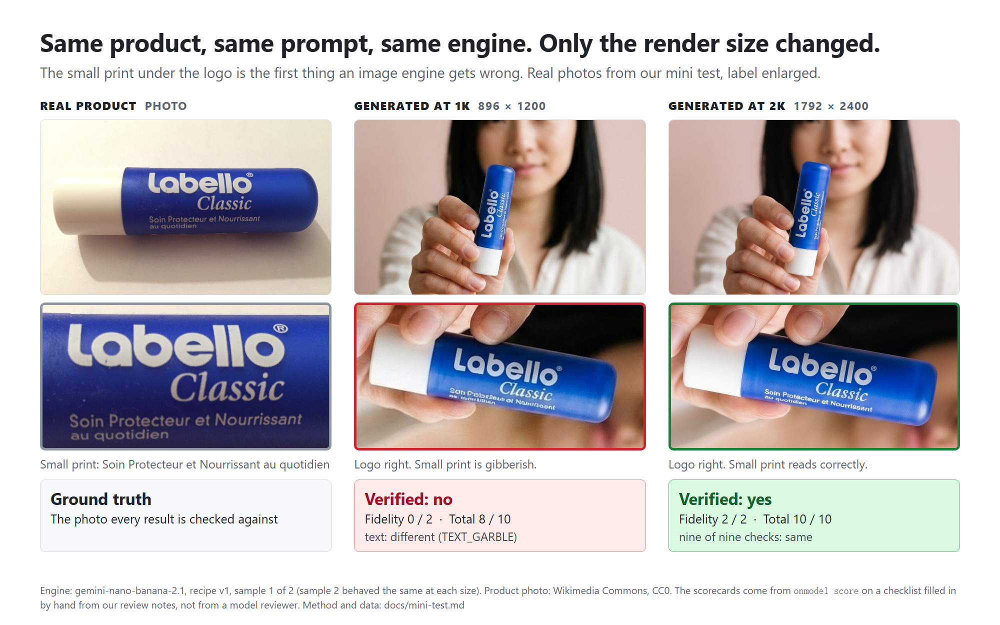
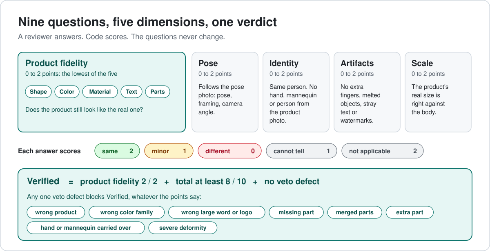
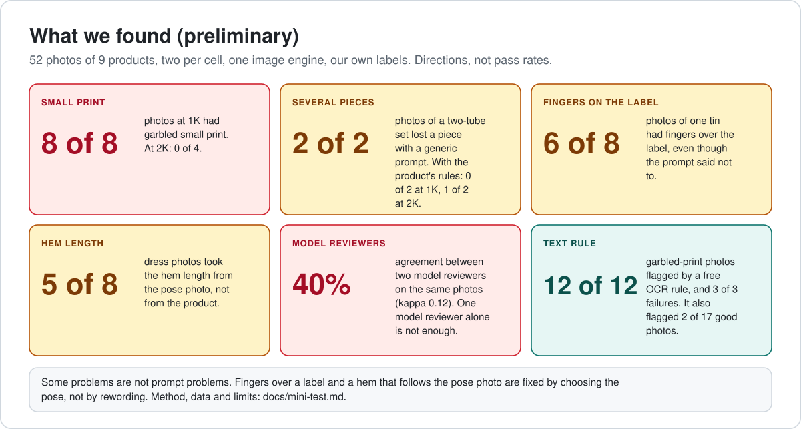
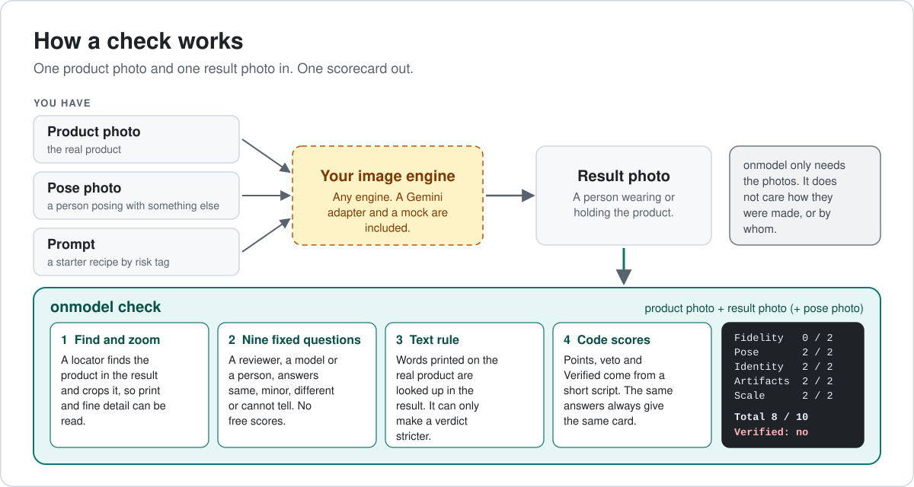
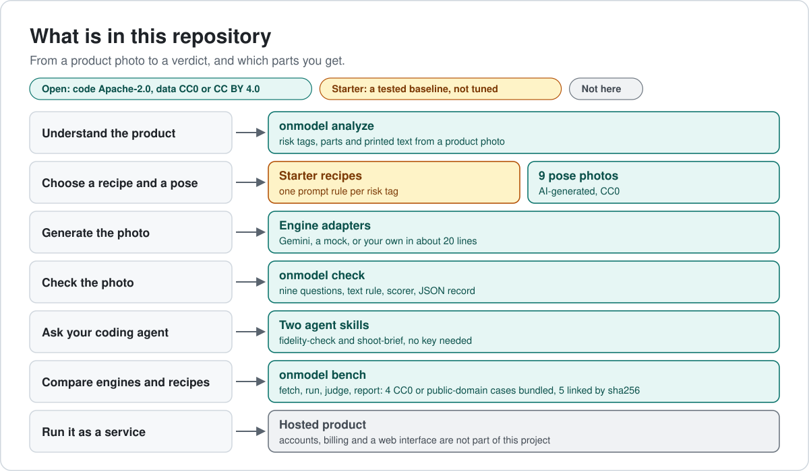

# onmodel

**AI 生成的上身图，还像你的商品吗？**
对照真实商品，评估 AI 商品摄影图：形状、颜色、材质、印刷文字、件数和比例。面向电商团队，以及做 AI 模特图、商品图生成或虚拟试穿工具的开发者。一条命令，或者给 Claude Code 装一个 agent skill，背后是一套开放的 LLM-as-a-judge 基准。

[](LICENSE)
[](https://github.com/molly554/onmodel/actions/workflows/ci.yml)
[English](README.md)



## 试一试

**作为 skill。** 用你自己的 agent 去看图，再跑一个很短的脚本。不需要密钥，脚本只需要 Python 3。

```bash
git clone https://github.com/molly554/onmodel
mkdir -p ~/.claude/skills && cp -r onmodel/skills/fidelity-check ~/.claude/skills/
```

按 Claude Code 的格式编写。其他能读 `SKILL.md` 文件夹的 agent 可以直接用同一个文件夹，我们还没有试过。第二个 skill `shoot-brief` 会在出图之前，把商品图变成一条提示词和一份风险清单。

**作为命令行。** 自备 Gemini 密钥。检查一张图时，图片会发送给 Google。

```bash
pip install git+https://github.com/molly554/onmodel
export GEMINI_API_KEY=your-key
onmodel check product.jpg result.jpg --verb holding --tags text,hand
```

退出码：通过（Verified）为 0，不通过为 1，出错为 2，所以它也可以在脚本里当关卡用。`onmodel score`、`onmodel recipe` 和 `onmodel bench smoke` 不需要密钥，也不需要联网。

## 怎么用

用你自己的话问你的 agent：

```
这张 AI 图还像我的商品吗？[product.jpg] [result.jpg]
发布之前，帮我检查这 12 张商品图。
这张图上的标签文字好像不对，应该怎么改？
```

你会得到一张评分卡。下面是 `onmodel score skills/fidelity-check/references/checklist-example.json` 的真实输出：

```
 Fidelity   0 / 2 text: small print under the logo is gibberish
 Pose       2 / 2
 Identity   2 / 2
 Artifacts  2 / 2
 Scale      2 / 2
 ----------------------------------------------------------------
 Total 8 / 10   Veto: none   Verified: no (product fidelity is 0 / 2 (text))
 Fix: Render at 2K or higher and keep the label facing the camera.
```

它是第一道筛查，不是证书：它指出看起来不对的地方，读不清就答「无法判断」（cannot tell），并给出修改建议。

## 检查什么



由审查者（模型或真人）回答九个固定问题，再由一段很短的脚本算出分数、一票否决和结论，所以同样的回答永远得到同一张评分卡。另有一条免费的文字规则：把真实商品上印的字，和结果图里还能读出来的字做对比。见 [评分表](spec/rubric.md)、[「Verified」是什么意思](spec/verified.md)、[失败码](spec/failure-taxonomy.md)。

## 我们的初步发现



来自我们自己的 mini 测试：9 件商品、52 张图、每格 2 张、只用了一个出图引擎，标签由我们在 AI 协助下标注。这些是方向，不是通过率。那次测试里的模型审查者用的是更早的、自由打 0 到 2 分的提示词；`onmodel check` 里的清单式协议是针对这些发现重新设计的，**还没有用真人标注校准过**。方法、数据和注意事项见 [docs/mini-test.md](docs/mini-test.md)（英文）。

## 工作原理



## 用你自己的引擎跑基准

```bash
git clone https://github.com/molly554/onmodel && cd onmodel && pip install -e ".[dev]"
onmodel bench smoke                                                # 整条流水线，离线运行，不要密钥
onmodel bench fetch                                                # 下载 5 张外链商品图，并核对 sha256
onmodel bench run --engine gemini-nano-banana-2.1 --res 2k         # 干跑：只列出计划和预估成本
onmodel bench run --engine gemini-nano-banana-2.1 --res 2k --out my-run --yes
onmodel bench judge --run my-run
onmodel bench report --run my-run
```

密钥只从环境变量读取，不会打印，也不会写入文件。运行到 `--budget` 就会停，可以续跑。接入别的引擎大约二十行：[docs/bring-your-engine.md](docs/bring-your-engine.md)（英文）。

## 仓库里有什么



| 内容 | 授权 |
|---|---|
| 代码、规范、入门配方、skills | Apache-2.0 |
| 图表与标注 | CC BY 4.0 |
| 4 张随库商品图、9 张姿势图、mini 测试生成的图 | CC0 或公有领域 |
| 5 张外链商品图（CC BY-SA） | 不复制：`onmodel bench fetch` 会下载并核对 sha256 |

每张图的作者、授权和来源都列在 [bench/ASSETS.json](bench/ASSETS.json) 和 [ATTRIBUTION.md](ATTRIBUTION.md) 里，每次推送都有脚本核对。

## 局限

- 这次测试由一家做图像产品的厂商自己跑。复跑所需的一切都在这里。
- 只测了一个出图引擎（Gemini），每格 2 张，只测了一种任务（换品式）。
- 标签是我们自己在 AI 协助下做的，不是独立的真人标注；mini 测试里的审查者也是 Gemini 模型。
- 文字规则是用 Windows 自带的 OCR、在定阈值的同一批图上测的；随库发布的 OCR 是 Tesseract，我们还没有测过。
- 黄金样品集很小：只有 9 个案例。
- 这些 skill 只测过脚本和格式，没有测过 agent 照着做的可靠程度。
- 「Verified」只表示通过了一次筛查。发布之前，请自己再看一眼。

## 路线

计划中，不设日期：我们自己拍摄的黄金样品集（12 件商品）、两个人标注的 150 张以上图、每个审查者的校准卡、更多引擎。在审查者校准之前，不发布榜单。

## 参与

欢迎提 issue、引擎适配器、修复和失败案例报告。暂时不接收新的图片和配方，因为我们无法核实它们的来源。见 [CONTRIBUTING.md](CONTRIBUTING.md)。

## 引用与授权

见 [CITATION.cff](CITATION.cff)。Apache-2.0：[LICENSE](LICENSE)、[NOTICE](NOTICE)。

---

维护者：[@molly554](https://github.com/molly554)。来自 [WearAI](https://wearai.net) 团队。
